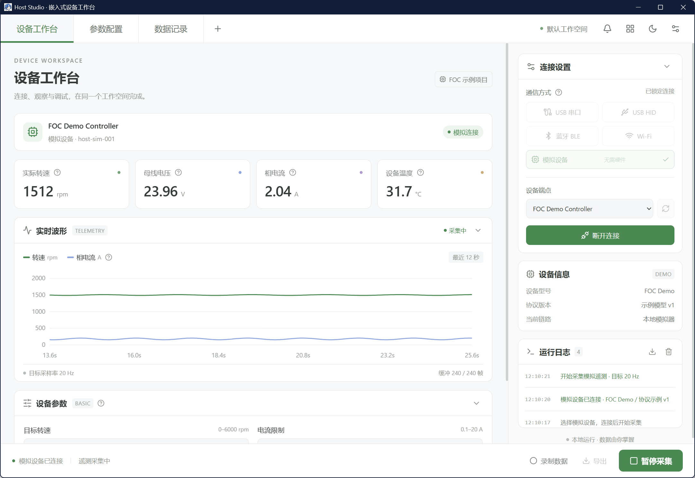

# Host Studio

**面向嵌入式设备的可扩展上位机框架。** 使用 Rust + Tauri 2 + Vue 3 + TypeScript 构建，分离通信链路、设备协议、业务逻辑与工作台界面。你可以复用底层收发能力和桌面交互流程，为不同设备实现各自的协议适配与专用页面。

> 已提供可运行的模拟器、工作台和多种链路适配接口；**真实设备的协议解析、握手及业务会话需按设备实现**。扫描到端点、打开通信链路与设备协议就绪是不同的阶段。



## 通信与协议适配

| 通信方式 | 当前能力 | 适配真实设备还需要 |
| --- | --- | --- |
| 串口（含 USB CDC） | Rust 串口收发接口；桌面端扫描串口端点 | 串口配置、消息分帧和设备协议 |
| TCP / UDP | Rust 网络链路收发接口 | 地址配置、消息边界或报文策略、设备协议 |
| USB HID | Rust HID 报告收发接口；桌面端扫描 HID 端点 | VID/PID、报告格式与长度、设备协议 |
| BLE GATT | Rust GATT 收发接口；桌面端扫描 BLE 端点 | 服务与特征选择、分片重组、设备协议 |

通信层只负责发现端点和收发数据，不把串口字节、HID 报告或 BLE 特征预设为某一种设备命令。不同设备可以在此之上实现自己的帧格式、校验、身份与版本握手、参数语义和遥测解析。**这表示框架可扩展以适配不同通信协议，不表示已开箱兼容任意现成设备或固件。**

目前 USB 支持 HID 链路，USB CDC 走串口；不包含 USB Bulk/WinUSB。蓝牙支持 BLE GATT，不包含经典蓝牙 SPP。网络接口提供 TCP/UDP 数据链路，不负责 Wi-Fi 入网、配网或热点管理。上述链路接口目前尚未接入工作台的真实设备业务流程。

## 当前可用功能

- 模拟设备连接/断开、参数读取与应用、参数范围校验；桌面端使用 Rust 模拟器，浏览器预览使用前端模拟器，无需硬件。
- 模拟遥测轮询（目标 20 Hz）、最近 240 帧波形；最多 12,000 帧的内存录制与 CSV 导出。
- 参数 JSON 导入/导出、运行日志导出、明暗主题和设备工作台页面。
- 桌面端扫描串口、USB HID、BLE 端点；底层链路接口可供新设备模块复用。

内置模拟器采用一组电机参数作为**演示数据模型**，不是框架对设备类型的限制，也不保证兼容任何现有固件的线协议。模拟参数不会写入真实设备或非易失存储；模拟采样时间也不代表真实设备时钟。

## 快速开始

默认开发环境为 Windows。先准备 Node.js（含 npm）、Rust **MSVC** 工具链、Visual Studio C++ Build Tools 和 WebView2 运行时；其他平台请按 Tauri 2 的要求安装依赖，本项目尚未完成跨平台实机验收。

```powershell
npm ci
npm run tauri dev
```

在桌面窗口中选择「模拟设备」→「连接设备」→「开始采集」。在「参数配置」中修改参数后点击「应用参数」；在「数据记录」中录制并导出 CSV。导入 JSON 只更新编辑区，需要手动应用；录制保存在内存中，关闭页面或开始新录制前请导出。

只预览工作台及模拟流程，可以运行：

```powershell
npm run dev
```

浏览器打开终端显示的本地地址（默认端口 **1420**）。浏览器模式不具备硬件扫描能力；在当前桌面工作台中，非模拟连接方式仅提供串口、HID、BLE 的端点扫描/展示入口，**真实设备连接按钮仍不可用**。TCP/UDP 链路接口存在于 Rust 库中，但工作台尚未实现真实网络设备连接。

## 如何接入设备

1. **取得设备契约：** 明确连接配置、消息边界、字节序与校验、身份/版本、请求应答、遥测和参数语义。不要将端点扫描结果视为协议兼容证明。
2. **实现协议模块：** 在设备专用模块中编解码消息，处理字节流半包/粘包或报文丢失/乱序，并以固定报文测试边界与错误情况。
3. **实现设备会话：** 选择合适的 `host-transport` 链路，加入握手、请求关联、超时、断线清理和读回确认；这些是新设备需要实现的能力，当前不是现成的通用会话服务。
4. **接入工作台：** 通过类型化 Tauri 命令提供设备业务接口，后端校验参数，再实现设备专用页面；先用模拟/回环验证，再根据授权进行实机验收。

参见 [架构说明](docs/architecture.md) 与 [开发指南](AGENTS.md)。

## 项目结构

| 路径 | 职责 |
| --- | --- |
| [`crates/host-core`](crates/host-core/src/lib.rs) | 当前示例参数模型、校验和模拟设备 |
| [`crates/host-transport`](crates/host-transport/src/lib.rs) | 与设备业务无关的端点发现和链路收发 |
| [`src-tauri`](src-tauri/src/lib.rs) | 桌面应用、Tauri 状态与命令桥 |
| [`src/api.ts`](src/api.ts) | 类型化前端接口与浏览器模拟器 |
| [`src/App.vue`](src/App.vue) | 工作台界面；[`src/HelpTip.vue`](src/HelpTip.vue) 提供通用提示 |
| [`docs/architecture.md`](docs/architecture.md) | 分层与扩展约定 |
| [`docs/verification.md`](docs/verification.md) | 既往验证记录及其范围 |

## 当前限制

- 工作台目前只支持模拟设备的完整业务闭环；扫描、链路收发接口与真正的设备协议连接不是同一项功能。
- 尚未实现通用设备注册、描述式参数、多设备、自动重连、固件升级、录制回放或高吞吐生产采集。
- 模拟遥测使用轮询，不能作为实时控制或安全保护依据；真实设备的启停与限流保护必须由设备端负责。
- 串口、USB、BLE 实机验收、跨平台完整验收和安装器验收尚未完成。[历史验证记录](docs/verification.md) 不代表当前提交或任何真实设备已通过测试。

## 检查与构建

```powershell
npm run build
cargo fmt --all -- --check
cargo check --workspace
cargo test --workspace
```

在 Windows 上验证桌面应用集成、但不打包安装器：

```powershell
npm run tauri build -- --debug --no-bundle
```

如需尝试 Windows 安装包，运行 `npm run tauri build`；当前目标为 NSIS，构建过程可能需要下载额外工具。构建通过不等于完成真实设备或安装器验收。

## 许可证

本项目采用 [MIT License](LICENSE)。
