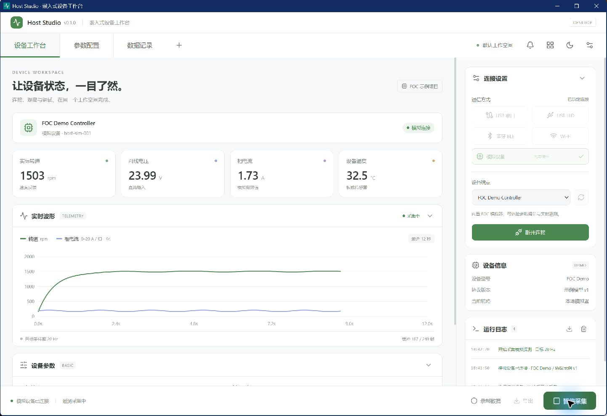

# 首版验证记录

验证环境：Windows，2026-10-24。

- 前端 TypeScript 检查和 Vite 生产构建通过。
- cargo check --workspace 通过。
- cargo test --workspace：4 项测试通过（非有限值与范围校验、无效写入原子性、模拟器跟踪目标值、TCP 回环字节完整性）。
- Tauri debug 桌面构建通过，输出 target/debug/host-studio.exe。
- 浏览器交互验证：连接、采集、目标转速从 1500 修改至 2400、应用参数、录制 2294 帧、触发 CSV 下载。
- 原生 Windows 窗口验证：加载打包资源、DESKTOP 环境识别、Rust 模拟器连接、遥测更新及曲线渲染。
- 视觉检查修复：禁止右侧卡片 flex 收缩，避免连接按钮被裁切。
- 尚未验证：USB/串口/BLE 实机收发、跨平台运行、安装器和代码签名。

## 图标更新验证（2026-10-24）

- 使用用户提供的原图，通过 Tauri icon 生成桌面图标资源，未重绘原图。
- 更新应用图标、窗口标题栏、界面标识、帮助弹窗标识和网页 favicon。
- 前端类型检查、生产构建及 Tauri debug 桌面构建通过。
- 启动桌面程序截图核对，标题栏和左上角标识均显示新图片。
- 此次为图标替换，未重新执行通信实机测试。

## 通用界面更新验证（2026-10-27）

- 新增独立 HelpTip 组件，将指标、参数应用、配置导入导出、录制限制、通信方式和电流波形的解释收进问号提示；数值、单位、范围和实际状态保持可见。
- 基础字号从 14 px 调至 16 px，现有固定字号及 canvas 字体增加 2 px；侧栏、单位标签和 390 px 参数布局同步调整。页首改用实际页面名称。
- 前端 TypeScript 检查和 Vite 生产构建通过。
- 桌面资源编译和 Rust 链接完成；原 `target/debug/host-studio.exe` 被运行中的程序占用，未关闭该程序，使用新链接的独立预览程序验证。
- Windows WebView2 模拟流程通过：悬停与聚焦显示提示、Esc 收起、提示边界、16 px 基础字号、连接与断开、遥测、修改/应用/读取参数、录制与 CSV 导出。
- 1440 px 桌面、暗色主题以及 390 px 工作台/参数/记录页面检查通过，右侧卡片和连接按钮未被裁切；已检查截图。
- 相关截图和独立预览程序在本机忽略的 `target/ui-review/` 下，不作为可移植构建依赖。
- 此次仅修改框架通用界面和说明文档，未更改通信协议，未运行实机命令、硬件扫描或安装器验收。

## 顶部栏移除与 Release 验证（2026-10-27）

- 移除独立的应用信息栏及其样式，页面直接从标签导航开始；保留系统窗口和帮助弹窗中的应用图标。
- `cargo fmt --all -- --check` 通过；`cargo test --workspace` 的 4 项测试全部通过。
- `npm run tauri build -- --no-bundle` 成功，Release 可执行程序为 `target/release/host-studio.exe`。
- 对该 Release 程序完成 Windows WebView2 模拟验证：顶部栏不存在且标签导航置顶，问号悬停/聚焦/Esc、参数读写、遥测、录制、CSV 导出、暗色主题及 390 px 窄屏检查通过。
- 尝试默认安装包构建时，NSIS 3.13 工具从官方 GitHub 下载超时，因此此次未生成安装器；可执行程序已单独构建并验证。未运行真实设备操作。
